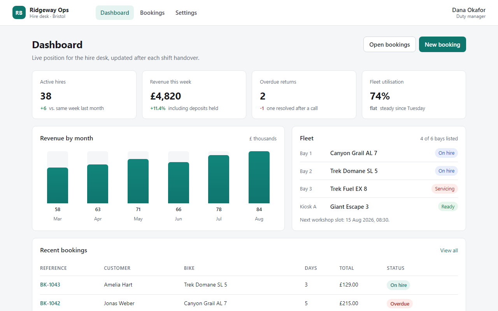
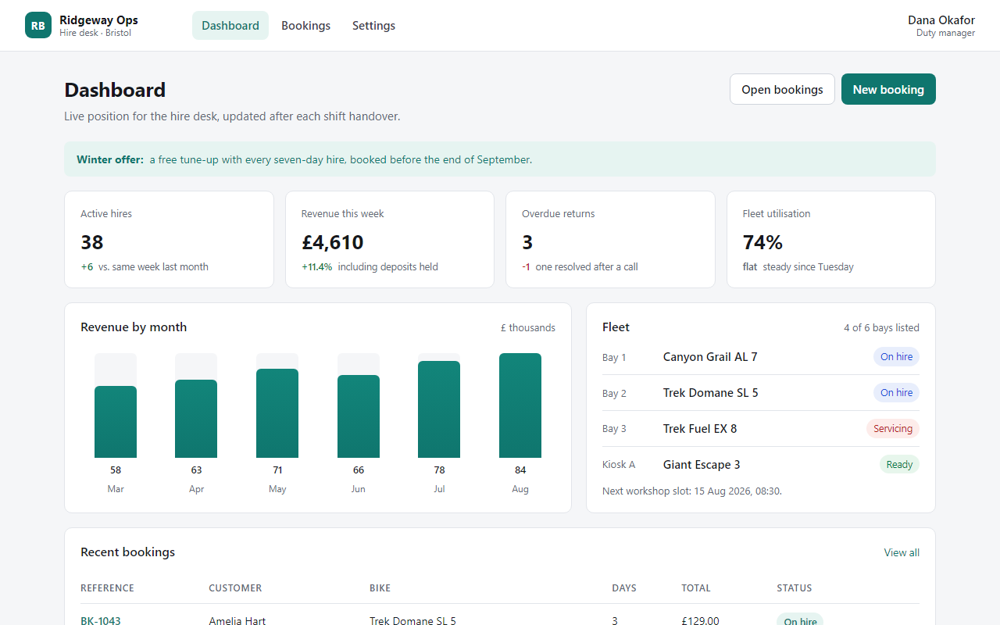
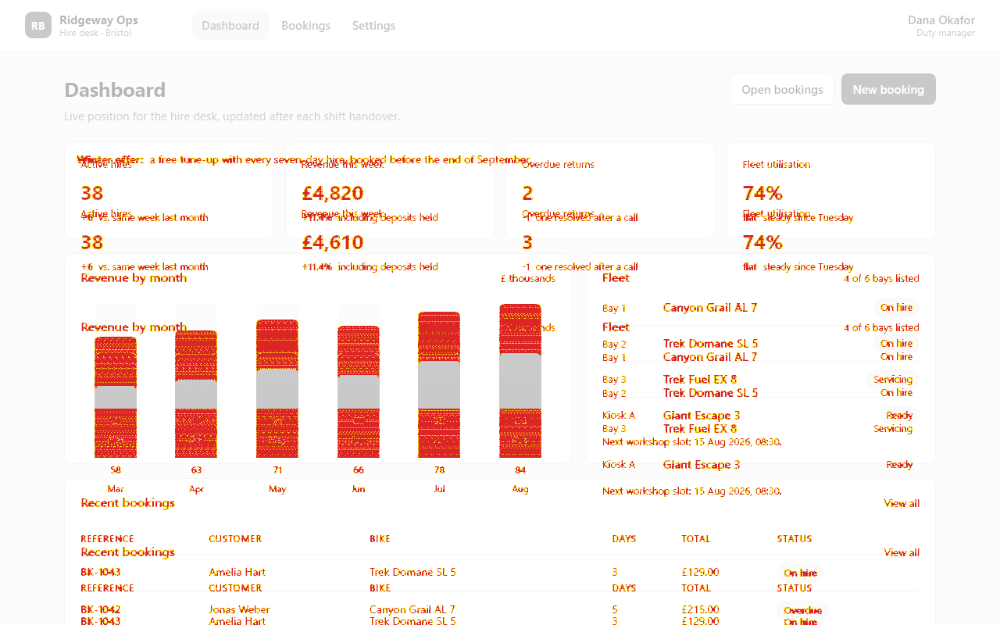
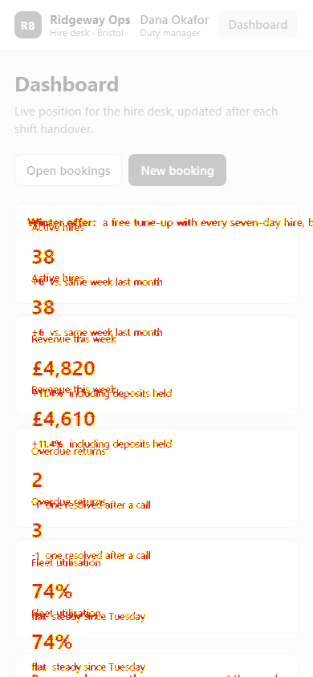

# Phase 6 — the independent developer pilot

UIProof had only ever been used on its own repository: the example app, the demo fixtures and the
`/support` route were written by the same person who wrote the checker. This phase installs the CLI
into a separate application, with its own design and its own defects, and records what actually
happened — including the parts that did not work.

**Outcome:** the tool found every planted regression, reported no false positives on the screens that
did not change, and gated a pull request correctly. Getting there exposed one blocking product gap
(UIProof could not be installed at all) and three reporting problems, all fixed here. The pilot also
left the trust boundary of a guest CI setup weaker than UIProof's own gates, which is written down in
[§10](#10-remaining-trust-boundary-weaknesses) rather than papered over.

---

## 1 · What was piloted

| | |
| --- | --- |
| Application | **Ridgeway Ops** — an internal hire-desk console for a fictional bike-rental business |
| Location | `C:\Users\azmrk\Documents\GitHub\uiproof-pilot` — a sibling directory, its own git repository, no shared code with UIProof |
| Stack | Next.js 16.4.1 (App Router, TypeScript), four routes, hand-written CSS with two breakpoints |
| Routes | `/` (dashboard), `/bookings` (list + filters), `/bookings/BK-1043` (detail), `/settings` (form) |
| Viewports | `desktop` (1280×800) and `mobile` (390×844) were baselined; `tablet` (834×1112) is audited by `uiproof audit` whether it was approved or not |
| UIProof | `uiproof@0.1.0`, packed from `e98b257` and installed as `file:vendor/uiproof-0.1.0.tgz` |
| Browser | Playwright's Chromium 1.64.1, already present on the machine |

The app was written for this pilot from scratch, not adapted from a personal project, and nothing in
it exists to make UIProof look good: it uses ordinary tables that scroll on a phone, a nav that
scrolls at mobile, CSS gradients, and a form with labels, radio buttons and checkboxes.

The screens under test (approved desktop captures):



---

## 2 · Distribution: the pilot's first finding was that it could not start

The brief asked for a reproducible local distribution. UIProof is not published to npm, so the
obvious move is a local dependency:

```bash
cd uiproof-pilot && pnpm add -D file:../uiproof
```

That installs the sources and nothing else. `package.json` had no `bin`, no built bundle and no
`files` allow-list, so the install produced **no `uiproof` command** — `pnpm exec uiproof` fails with
"command not found", and the only way to run the tool was `node ../uiproof/scripts/uiproof.mjs`,
which ties the consumer to a checkout on the same disk and has no version.

This is a blocking onboarding defect, not a preference, so it was fixed before the pilot continued:

| Change | Why |
| --- | --- |
| `bin: { "uiproof": "./bin/uiproof.mjs" }` | the package exposes a command |
| `files: ["bin/", "dist/cli/"]` | a tarball carries the CLI bundle and the launcher, not the Next.js app, tests and fixtures |
| `prepack` → `node scripts/uiproof.mjs --build-only --out dist/cli/uiproof.mjs` | `pnpm pack` builds the same esbuild bundle `pnpm uiproof` uses; the consumer never compiles TypeScript |
| [`bin/uiproof.mjs`](../bin/uiproof.mjs) | spawns the bundled CLI and maps a signal to exit `2` ("the tool could not answer"), never to a pass |
| `dist/` in `.gitignore` and in ESLint's ignores | the generated bundle is build output, not source |

The result:

```bash
cd uiproof && pnpm pack --pack-destination /tmp      # 354 KB: bin/, dist/cli/, package.json, README
cd uiproof-pilot && pnpm add -D file:../.../uiproof-0.1.0.tgz
pnpm exec playwright install chromium                 # browsers are not part of the tarball
pnpm exec uiproof --version                           # 0.1.0
```

Measured: **40.5 s** for the first install (48 packages — Playwright, `axe-core`, `pixelmatch`,
`pngjs`), **7 s** to reinstall after repacking. Packing takes a few seconds and prints the file list.

This is still not "npm install uiproof". The README now documents the tarball, and
[§13](#13-limitations) is explicit that publishing is a separate step that has not been taken.

---

## 3 · Setup: four commands and one JSON file

Following the README after adding the install step, with a stopwatch:

| Step | Command | Time |
| --- | --- | --- |
| Build the app | `pnpm build` | 18 s (Next.js, 11 pages) |
| Start it | `pnpm start` (127.0.0.1:4310) | < 1 s to answer |
| Declare it | `uiproof.config.json` with four routes and no `allowedOrigins` | ~3 min including reading the field table |
| Check the registry | `uiproof projects` | 0.6 s |
| First capture + approval | `uiproof capture --route dashboard --viewport desktop --approve --quality` | **2.6 s** (capture 986 ms at 1280×800) |

`uiproof projects` printed exactly the file that was written:

```text
1 project(s) in …\uiproof-pilot\uiproof.config.json
  ridgeway-ops — Ridgeway Ops (http://127.0.0.1:4310)
      dashboard        /  ·  Dashboard
      bookings         /bookings  ·  Bookings
      booking-detail   /bookings/BK-1043  ·  Booking BK-1043
      settings         /settings  ·  Settings
```

Nothing else was needed: no project-local config beyond that one file, no plugin, no import in the
app, no build step, no changes to `next.config.ts`. This is the part of the tool that works best.

---

## 4 · Approved baselines

Eight approvals (four routes × desktop, mobile), each with `--quality` so the approved version also
carries the accessibility snapshot `--new-only` later needs:

```bash
uiproof capture --project ridgeway-ops --route <id> --viewport <desktop|mobile> --approve --quality
```

- **All eight in 11 s**, 0.7–2.3 s of Chromium work each.
- Repacking the same approvals: `baselines export --project ridgeway-ops --out uiproof-baselines` →
  **528 KB**, one JSON manifest and nine PNGs (dashboard desktop has two versions from the setup
  exercise). That bundle is committed in the pilot repo, which is the intended workflow.
- On a **wiped store**, `baselines import --from uiproof-baselines --activate` restored every version
  and reported `9 version(s) carried an accessibility snapshot`; the very next `check` reported
  `PASS 0%`.
- Immediately after approval, **8 of 8 checks reported exactly 0 changed pixels** on this machine.

The `--quality` flag is the one non-obvious step: without it an approval is a screenshot with no
accessibility reference, and `--new-only` has nothing to compare against. The CLI says so in the
import output, but a developer learning the tool will probably hit it once.

### The containment rule held

The bookings table is wider than a phone and sits in an `overflow-x: auto` wrapper, and the mobile nav
scrolls horizontally. Neither was reported as a layout defect:

```text
responsive — document scrolls 0px horizontally
  … nav > a.nav-link.nav-active overflows 154.38px inside a scrollable region (… nav) — not a defect
```

At mobile the same scrolling made 24 contrast checks undecidable ("background colour could not be
determined because it is partially obscured"), and those were carried as **needs review**, not as
failures. The verdict passed. That is the correct answer for an element that scrolls out of the
measurement area, and it is the case a naive implementation gets wrong in both directions.

---

## 5 · Real regressions, detected

Four changes were made as ordinary edits to the app, committed together as a plausible "refresh"
rather than as test fixtures:

| Route | Edit | Kind |
| --- | --- | --- |
| `/` | Two KPI values changed (`£4,820`→`£4,610`, overdue `2`→`3`) and a 720 px-wide winter-promo strip added above the KPI grid | copy change + a fixed-width element |
| `/bookings` | The status filter's `<label htmlFor="booking-status">` replaced with `<span class="label">` — visually identical, semantically unlabelled | accessibility |
| `/settings` | New helper text under the email field, coloured `#a3a8b2` on white (~2.4:1) | contrast |
| `/bookings/BK-1043` | *nothing* — the control | — |

Results, from the installed CLI:

| Command | Exit | Result |
| --- | --- | --- |
| `check --route dashboard --viewport desktop` | **1** | `REGRESSION 5.3404%` (54,686 of 1,024,000 px) |
| `check --route dashboard --viewport mobile` | **1** | `REGRESSION 2.1269%` (7,001 of 329,160 px) |
| `check --route bookings --viewport desktop` | **0** | `PASS 0%` |
| `check --route booking-detail --viewport desktop` | **0** | `PASS 0%` |
| `audit --route bookings` | **1** | `accessibility.critical` — `select-name@#booking-status` |
| `audit --route settings --new-only` | **1** | `accessibility.serious` — `color-contrast@.hint-subtle` |
| `audit --route dashboard` | **1** | `responsive.document-overflow` — **348 px** at mobile, `element-overflow … div.promo +348px` |
| `audit --route booking-detail` | **0** | `QUALITY PASS`, 0 violations at all three viewports |

Click through the evidence:

| | |
| --- | --- |
| [](pilot/dashboard-desktop-approved.png) | [](pilot/dashboard-desktop-defect.png) |
| approved | after the "refresh" |
| [](pilot/dashboard-desktop-diff.png) | [](pilot/dashboard-mobile-diff.png) |
| the highlighted difference at desktop | the same at mobile, where the strip also escapes the 390 px viewport |

Three things are worth calling out because they are what a developer relies on:

1. **The visual gate and the accessibility gate caught different things.** The bookings page is
   pixel-identical to its approved screen (`PASS 0%`) and still fails the audit with a critical
   violation. Neither check subsumes the other, and the pilot is the first place that was tested on a
   page somebody else's code had "fixed".
2. **No cross-contamination.** The untouched detail route passed both gates while the page next to it
   was failing, so a red build points at the change that caused it.
3. **The severity was right.** A missing accessible name is `critical`, a 2.4:1 helper text is
   `serious`, and the mobile strip is a layout defect with the overflowing selector and its measured
   pixels — not a vague "something changed".

---

## 6 · Restore, and what "resolved" means

Reverting the whole change set (`git checkout -- app`) and re-running the gate:

- dashboard: `PASS 0%` at both viewports, `QUALITY PASS`;
- bookings: `QUALITY PASS`;
- settings: `QUALITY PASS`;
- the full gate script: **exit 0**, `GATE PASS — all routes match their approved screens, no new
  quality findings`.

A separate store was used to test the other direction — approving the **defective** page, then fixing
it:

| State | `audit --new-only` |
| --- | --- |
| defective page, approved while defective | `QUALITY PASS`, `new 0, known 1, resolved 0` — the tool does not fail a page against its own approved debt |
| same store, page fixed | `QUALITY PASS`, `new 0, known 0, resolved 1` — the fix is named, not just "green" |

### A trap worth writing down

`uiproof audit` audits **every** viewport preset. The first attempt at the table above approved only
desktop and mobile, and the same finding then failed as *new* at tablet, because an approval is
scoped to the viewport it was made at and tablet had none. That is the documented rule working as
designed, and the report says so (`no approved accessibility snapshot for tablet — findings measured
there count as new`), but it took a minute to understand. **Approve every viewport you audit** —
`capture --approve --quality` per viewport, or narrow the audit with `--viewport`.

---

## 7 · CI integration

The pilot app's gate is `scripts/ci-quality.sh` in the pilot checkout, driven by
`.github/workflows/uiproof.yml` in the same place: install, `playwright install chromium`, build,
start, then for every route run `check` at desktop and mobile and `audit --new-only`, uploading
`.uiproof/ci` as evidence. It lives with the pilot rather than here because it is that project's
policy, not UIProof's.

Running the script is a real rehearsal, because the workflow calls exactly that script. Measured:
**25–33 s** for four routes — eight visual checks and four audits of three viewports each, sixteen CLI
invocations. With the defects present it exited **1** and named four failures:

```text
✗ visual regression on dashboard at desktop          REGRESSION 5.3404%
✗ visual regression on dashboard at mobile           REGRESSION 2.1269%
✗ new accessibility or layout finding on dashboard   responsive.document-overflow (348px)
✗ new accessibility or layout finding on bookings    accessibility.critical select-name@#booking-status
GATE FAIL
```

After the restore the same script exited **0**. Two design choices carried over from UIProof's own
gates and are worth copying:

- **`--new-only` for the quality gate, `check` for the visual gate.** A pull request is judged on what
  it introduced, not on the debt the repository already has.
- **Import the bundle into a clean store first.** The gate never writes to the store it is judging
  from; it rebuilds `.uiproof/ci` from the committed bundle each run, so a stale local approval cannot
  make a pull request pass.

**Not verified:** the workflow has not run on GitHub Actions. The pilot repository has no remote, and
pushing one is outside what this task should do. The commands, the script and the failure/pass
behaviour are verified locally; the YAML has not been executed by a hosted runner.

---

## 8 · Onboarding experience

What the README got right, in the order a newcomer meets it:

| Step | Verdict |
| --- | --- |
| Registration file format and every field's rules | **Clear.** The table of `id` / `name` / `origin` / `routes` / `allowedOrigins` answers the questions that come up; `uiproof projects` confirms the result |
| Error messages | **Good.** A missing file, malformed JSON, a non-loopback origin, an unknown project and an unknown route each exit `2` and name the file and the offending value. An application that is not listening says so, and never looks like a UI change |
| Capture vs check | **Clear, and it says the right thing**: "a capture is not a pass" |
| Approval | **Clear.** `capture --approve` is one flag; versions are additive and named |
| Exit codes | **Clear.** `0` / `1` / `2` is the first thing in `--help` and it matches what the pilot observed |
| JSON output | **Usable.** `--json` emits exactly one document; `check --json`'s `report` is the persisted report |

Friction, in order of how much time it cost:

| # | Friction | Cost | Fixed? |
| --- | --- | --- | --- |
| 1 | **No install path**: no `bin`, no packed bundle, so a separate project could not run the CLI | blocking | **yes** — `bin/`, `files/`, `prepack` ([§2](#2-distribution-the-pilots-first-finding-was-that-it-could-not-start)) |
| 2 | **The audit listing did not distinguish a violation from a needs-review question.** A viewport printed `0 violation(s)` and then twenty `[serious] color-contrast` lines; nothing said which was which | confusing, and the kind of thing that gets a real failure waved through | **yes** — questions are marked `· needs review` |
| 3 | **The count itself was wrong**: `24 violation(s)` on a page whose only findings were 24 undecidable contrast questions (the total included needs-review results while the impact counts did not) | actively misleading | **yes** — the line counts violations, and reports the questions beside them |
| 4 | **`Evidence:` printed a store-relative path** (`audits/audit-…/audit.json`) while `capture` prints an absolute one, so the path could not be opened as printed | a minute per lookup | **yes** — the transcript prints the directory; the JSON keeps its store-relative `reportPath` because the API serves it that way |
| 5 | **`--new-only` needs an accessibility snapshot, and `capture` only records one with `--quality`.** Approving without it silently leaves `--new-only` with no reference | one wasted approval cycle | no code change; documented in the README's install/setup steps |
| 6 | **`--new-only` audits viewports you never approved** (tablet), and the finding fails as new there | one confused gate run | no code change; the rule is correct and the report already names the uncovered viewport. The README now says to approve every viewport you audit |
| 7 | Two hints repeated their message verbatim (`Start the application …` twice, `Create one, or pass --config` twice) | cosmetic | **yes** — one hint removed, the config hint now points at the example file |

Nothing else in the README was wrong. There was no step that turned out to be unnecessary, and no
command needed a flag the documentation did not mention.

---

## 9 · False positives

None observed, and the pilot is the first place that was checked on pages UIProof's author did not
write:

- **8 of 8** checks reported 0 % immediately after approval, on a page with gradients, a CSS chart,
  variable-height rows and a scrolling table.
- **0 changed pixels** on the untouched detail route while three other routes were failing.
- The bookings page's visual check stayed **green** through an edit that changed its accessible name
  and nothing else — no pixel noise from a semantic change.
- The deliberate horizontal scrollers were recorded as contained overflow, and the 24 undecidable
  contrast checks stayed questions. Neither inflated a verdict.
- After the fixes, the same 16-command gate passed twice in a row with identical results.

One thing the pilot did **not** test is cross-machine determinism: every capture came from one
Chromium on one Windows machine. UIProof's own gates pin a container image for exactly this reason,
and a guest repository that runs `check` on a different OS from the one that approved the baseline
should expect noise. The pilot's CI script would inherit that problem — see below.

---

## 10 · Remaining trust-boundary weaknesses

UIProof's own gates extract the checker from the base branch and run in a digest-pinned container;
[BRANCH-PROTECTION.md](BRANCH-PROTECTION.md) records exactly what that buys. **A guest repository does
not get that for free.** In the pilot's setup:

| Weakness | Consequence | Status |
| --- | --- | --- |
| **The CLI arrives as a committed tarball** (`vendor/uiproof-0.1.0.tgz`) | A pull request can replace the binary that judges it — the same class of attack as editing the checker, and here it is one file | not mitigated. A hash pin, a base-branch install, or a published package with a lockfile integrity hash is the fix |
| **Dependencies are installed from the pull request's lockfile** | `playwright`, `axe-core` and the image libraries the verdict depends on are resolved from the revision under test | not mitigated (same as UIProof's own stated limitation) |
| **The approved bundle lives in the branch** | A pull request can edit `uiproof-baselines/` and authorise its own change — the pilot's script imports whatever is in the working tree | not mitigated; UIProof's own gate solves this with `git archive` from the base branch, the pilot does not |
| **No branch protection** | The workflow is advisory until the two checks are marked *required* in GitHub | not configured — the pilot has no remote |
| **Screenshots are not reproducible across machines** | A baseline approved on Windows will not match a Linux runner byte for byte; the gate would fail for the wrong reason | not addressed; the honest mitigation is approving inside the same pinned image |
| **The gate is a script, not a workflow-verified artifact** | Deleting or editing `scripts/ci-quality.sh` in a pull request changes the verdict | falls under the same CODEOWNERS/branch-protection requirement as the tarball |
| **`uiproof audit` cannot gate "needs review"** | A page that returns 24 undecidable contrast checks passes | by design; deciding them is a human's job, and the report says so |

None of this is a UIProof defect — it is the difference between "a repository that has configured its
protection" and "a repository that has a workflow". The pilot's value is that the difference is now
written down for a guest, not just for the project's own CI.

---

## 11 · Could a developer adopt it from the README alone?

**Before this phase: no.** Not because the documentation was wrong, but because there was no way to
install the tool into the project the README told you to register. The reader would clone UIProof,
read "Testing your own local application", write the config file, and then find no `uiproof` command
in the project they were told to run it from.

**After the install section added in this phase: yes, with one caveat.** The steps that were actually
followed — pack, install, install the browser, declare the routes, capture and approve, check, audit,
export/import, gate — are the steps the README now documents, and each one behaved as described. The
caveat is the one in [§13](#13-limitations): today that install is a tarball built from a checkout, not
a published package.

The realistic adoption cost for a small app, measured here: **about ten minutes** from "tarball in
hand" to eight approved baselines and a passing gate, plus the time to decide which routes and
viewports matter. The recurring cost is 3 s per route for a visual check and 3.5 s per route for a
three-viewport audit.

---

## 12 · What was changed in UIProof because of the pilot

Only what the pilot demonstrated. Every item below was observed first, then fixed:

| File | Change |
| --- | --- |
| [`package.json`](../package.json), [`bin/uiproof.mjs`](../bin/uiproof.mjs), [`scripts/uiproof.mjs`](../scripts/uiproof.mjs) | the package is installable: `bin`, `files`, `prepack` builds `dist/cli/uiproof.mjs`, `--out` on the bundler, a launcher that maps a signal to exit `2` |
| [`src/cli/finding-lines.ts`](../src/cli/finding-lines.ts) | needs-review findings are marked, and the viewport count line counts violations instead of every finding |
| [`src/cli/main.ts`](../src/cli/main.ts) | uses that module; prints the absolute audit evidence directory; one duplicated hint removed; the config hint points at the example file |
| [`eslint.config.mjs`](../eslint.config.mjs), [`.gitignore`](../.gitignore) | the generated `dist/` bundle is not linted and not committed |
| [README](../README.md) | how to install the CLI into another project; approve every viewport you audit |
| [`src/cli/finding-lines.test.ts`](../src/cli/finding-lines.test.ts), [`e2e/quality.test.ts`](../e2e/quality.test.ts) | 7 unit tests for the formatter and the count line; the e2e audit asserts the printed evidence path is the one on disk |

One of these was self-inflicted. The bundling script that `pnpm pack` runs took its own output path
from `--out`, which is also `baselines export --out <dir>`'s flag — so every export and import broke.
The repository's browser suite failed on the next run (5 tests, across `e2e/cli.test.ts` and
`e2e/quality-hardening.test.ts`), the flag was renamed to `--bundle-out`, and both files were re-run
green. Packaging changes are as capable of breaking the product as source changes, and the existing
tests were what caught it.

No architecture changed, no new dependency was added, and the pilot application is not part of this
repository — it stays an independent checkout, which is the point.

---

## 13 · Limitations

- **Distribution is manual.** A tarball built from a checkout, installed with a `file:` specifier.
  Publishing to npm, versioning the package for consumers and shipping the browser download story are
  separate work and have not been done.
- **The pilot's CI workflow has never run on GitHub.** No remote exists for it; only the script it
  invokes was executed, locally.
- **Tablet has no approved baseline** in the pilot's committed bundle. The gate passes because the
  pages are clean at tablet, not because that viewport is covered; the same trap is documented in
  [§6](#a-trap-worth-writing-down).
- **Cross-machine screenshot determinism was not tested** — one machine, one Chromium.
- **The pilot app is not in this repository**, so its 4 routes, 3 defects and gate script are not
  covered by this project's test suite. The defects were applied, measured and reverted by hand
  (recorded in the pilot's own git history).
- **The trust boundary of a guest setup is weaker than UIProof's own** — see
  [§10](#10-remaining-trust-boundary-weaknesses). The pilot proves the tool *finds* real problems; it
  does not prove a guest CI can defend itself against a hostile pull request.
